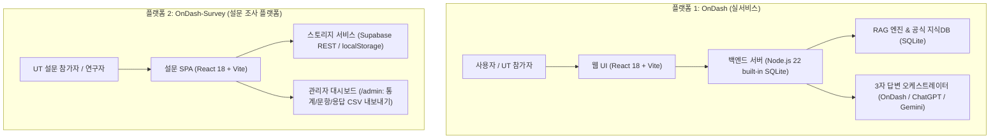
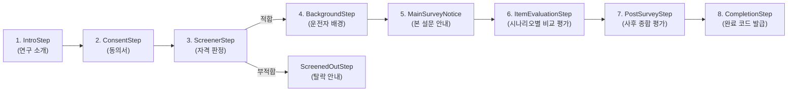

# OnDash & OnDash-Survey 플랫폼 분리 구축 및 완전 인수인계 명세서 (Handover Spec)

> **문서 버전:** v1.0.0  
> **최종 수정일:** 2026-10-13  
> **대상:** 다음 작업을 이어받을 LLM 및 엔지니어  
> **핵심 원칙:** 실서비스(OnDash)와 연구 설문(OnDash-Survey)을 100% 독립된 2개의 레포지토리 및 배포 단위로 완전 분리 구축

---

## 1. 프로젝트 분리 배경 및 전체 아키텍처

본 프로젝트는 원래 하나의 코드베이스 내에 **'차량용 AI 가이드 실서비스'**와 **'UT 평가용 연구 설문 시스템'**이 혼재되어 있었습니다. 이로 인해 메인 경로(`/`) 충돌, 배포 시 라우팅 꼬임, 유지보수 복잡도가 발생하는 문제가 있었습니다.

이를 근본적으로 해결하기 위해 **목적과 수명 주기가 다른 두 서비스를 완전히 독립된 2개의 플랫폼으로 분리**합니다.



| 구분 | 플랫폼 1: OnDash (실서비스) | 플랫폼 2: OnDash-Survey (설문 플랫폼) |
| :--- | :--- | :--- |
| **목적** | 2025 아이오닉 5 기준 차량 상황별 AI 안내 & 3자 답변 비교 | UT 참가자 대상 답변 신뢰도/유용성 평가 설문 및 데이터 수집 |
| **대상 사용자** | 실제 운전자, UT 시뮬레이션 참가자 | UT 연구 참가자, UX 연구원/관리자 |
| **기술 스택** | React 18, Vite, Node 22 (node:sqlite), Tailwind | React 18, Vite, Supabase REST API / localStorage |
| **아키텍처** | Full-Stack (SPA + 경량 Node.js 백엔드) | Client-Side SPA (정적 호스팅 가능) |
| **예상 배포 주소** | `https://ondash.onrender.com` | `https://ondash-survey.onrender.com` (또는 Vercel/Pages) |
| **비용 정책** | 완전 무료 (Render Free Tier, 외부 유료 API 없음) | 완전 무료 (정적 배포 + Supabase Free / 로컬스토리지) |

---

## 2. 플랫폼 1: OnDash (실서비스) 상세 명세

### 2.1 앱의 핵심 목적 & 원칙
* **기준 차량**: **한국 판매 사양 2025년형 현대 아이오닉 5 NE1 (ccNC 인포테인먼트)**
* **UT 비교 대상**: 동일 가상 상황 카드에 대해 다음 3개 답변 비교
  1. **우리 서비스 (OnDash)**: 공식 취급설명서에 근거한 절차적 안전 가이드
  2. **ChatGPT**: 일반 LLM 스타일 답변
  3. **Gemini**: 일반 LLM 스타일 답변
* **절대 준수 원칙**:
  * 확인되지 않은 매뉴얼 내용, 페이지 번호, 가짜 출처 환각(Hallucination) 절대 금지.
  * 공식 근거가 없으면 단정적인 안전 행동을 말하지 말고 **“등록된 공식 자료에서 이 상황을 뒷받침하는 근거를 찾지 못했습니다.”** 또는 **“차량 연식·사양에 맞는 근거를 확인할 수 없어 안전 행동을 단정할 수 없습니다.”** 로 처리.
  * 실제 GPS나 실시간 교통 연결 X (가상 상황 카드의 정보만 사용).
  * UT 평가 질문/모범 답변을 RAG 지식 DB에 오염시키지 말 것.

### 2.2 우리 서비스 답변 생성 구조 (출력 순서)
1. **지금 우선할 행동** (운전자가 즉시 취해야 할 액션)
2. **그 행동이 필요한 이유**
3. **상황에서 확인할 조건**
4. **하지 말아야 할 행동 또는 주의점**
5. **다음 단계** (정비소, 긴급출동 등)
6. **판단할 수 없는 부분** (차량 센서/현장 미확인 요소)
7. **근거**: 문서명, 해당 절/페이지, 공식 URL, 확인 일자

### 2.3 UI/UX 및 인터랙션 구현 규칙 (반드시 유지할 사항)
1. **헤더 & 시나리오 모달**:
   * 상단 헤더에 'UT 가상 상황' 요약 및 우측 '시나리오 전환' 버튼 배치.
   * **홈 화면 중간에 중복되었던 'UT 가상 상황' 카드는 삭제 상태 유지**.
   * 시나리오 전환 클릭 시: 검정 박스 대신 깔끔하고 시원한 모달 타이틀(새 뎁스), **실린더 아이콘 삭제**.
2. **맞춤 예상 질문 동적 위치 로직 (중복 노출 방지)**:
   * **질문 전(첫 화면/초기 상태)**: 홈 중앙 카드 영역에 '현재 상황 맞춤 예상 질문' 노출.
   * **질문 후(채팅 대화 시작 후)**: 홈 중앙에서는 사라지고, **채팅창 위(인풋창 바로 상단)** 에만 노출.
3. **애니메이션 & 인터랙션**:
   * 예상 질문 및 AI 답변 등장 시 **부드럽고 살짝 여유 있는 애니메이션** (`opacity 0 -> 1`, `translateY 12px -> 0`, `transition 400~500ms cubic-bezier(0.16, 1, 0.3, 1)`).
   * 모든 클릭 요소(버튼, 추천 질문 칩, 탭 등)에 미세한 탭 피드백(`scale(0.97~0.98)`의 부드러운 눌림 효과).
4. **시각적 위계 및 텍스트 정리**:
   * `'3가지 확인 후에도 문제가 지속되나요? 전문가 웹 검색 추가 안내'` 섹션:
     * `'3가지 확인 후에도 문제가 지속되나요?'` 와 다음 단락 사이에 확실한 줄바꿈/여백 분리.
     * 빨강/초록/보라색의 과도한 원색 남발 금지. 신뢰감을 주는 모노톤/슬레이트 계열 배경 및 명확한 폰트 굵기(Bold/Medium), 텍스트 크기(14px/12px) 위계 적용.

### 2.4 코드 구조 및 백엔드 설정
* **위치**: `/Users/yunjung/.gemini/antigravity/scratch/my-car-guide`
* **Git Remote**: `https://github.com/eeyunjung/OnDash.git` (branch: `main`)
* **핵심 파일**:
  * `src/main.jsx`: `<App />`을 메인으로 직접 마운트
  * `src/App.jsx`: OnDash 메인 컨테이너 (홈, 히스토리, 마이페이지 탭, 시나리오/지식 모달 연동)
  * `src/components/HomeTab.jsx`: 홈 화면, 상황 카드, 채팅창, 3가지 답변 비교 카드
  * `server/index.js`: Node.js HTTP 서버 (포트 3000 또는 `process.env.PORT`)
  * `server/db.js`: Node.js 22 built-in `node:sqlite` 기반 내장 DB
  * `server/rag.js`: 아이오닉 5 공식 매뉴얼 검색 엔진
  * `server/orchestrator.js`: 우리 서비스 / ChatGPT / Gemini 비교 답변 생성 엔진
* **배포 환경 (Render)**:
  * Runtime: Node
  * Build Command: `npm install && npm run build`
  * Start Command: `npm start`
  * 환경변수: `NODE_VERSION=22` (필수: `node:sqlite` 구동 목적)
  * Plan: Free ($0/mo)

---

## 3. 플랫폼 2: OnDash-Survey (설문 조사 플랫폼) 상세 명세

### 3.1 플랫폼 목적 & 프로세스
UT 참가자가 3가지 AI 시스템(OnDash, ChatGPT, Gemini)의 답변을 비교 검토하고, 체계적인 설문 데이터를 생성/수집하는 독립 설문 SPA입니다.



### 3.2 핵심 기능
1. **문항 은행 및 균형 배정 (`src/questionsBank.js`)**:
   * 참가자별로 시나리오 노출 순서 및 AI 답변 순서가 편향되지 않도록 균형 할당.
2. **평가 인터페이스 (`src/components/LikertScale.jsx`)**:
   * 5점/7점 리커트 척도 기반 명확한 설문 인터랙션.
3. **하이브리드 스토리지 (`src/storageService.js`)**:
   * **Supabase 모드**: `VITE_SUPABASE_URL`, `VITE_SUPABASE_ANON_KEY`가 있으면 원격 DB로 실시간 자동 수집.
   * **로컬 테스트 모드**: 키가 없어도 브라우저 `localStorage`에 자동 저장되며 관리자 페이지에서 즉시 확인 가능.
4. **관리자 대시보드 (`src/admin/SurveyAdmin.jsx`)**:
   * 진입 경로: `/admin` 또는 URL 해시 `#admin`
   * 기능:
     * **Summary**: 참가자 수, 완료율, 평균 소요 시간
     * **Items**: 문항별 노출 횟수 및 평가 통계
     * **Responses**: 참가자별 원본 응답 상세 조회
     * **Analytics**: 시스템별(OnDash vs ChatGPT vs Gemini) 선호도 및 점수 비교 시각화
     * **Export**: 연구용 CSV / JSON 원클릭 다운로드

### 3.3 코드 구조 및 저장소 준비 상태
* **로컬 위치**: `/Users/yunjung/.gemini/antigravity/scratch/ondash-survey`
* **빌드 검증**: `npm run build` 테스트 완료 (에러 0, 완전 독립 구동 확인)
* **Git 상태**: Git repo 초기화 완료 (`main` 브랜치에 초기 커밋 완료)
* **푸시 예정 원격 주소**: 사용자가 GitHub에 생성할 `https://github.com/eeyunjung/ondash-survey.git`

---

## 4. 인수인계 체크리스트 및 다음 LLM 작업 가이드

다음 LLM이나 작업자는 아래 순서에 따라 작업을 진행하면 됩니다:

### 실서비스 (OnDash) 관련 작업 시:
- [ ] 작업 디렉토리: `/Users/yunjung/.gemini/antigravity/scratch/my-car-guide`
- [ ] 설문 관련 코드는 절대 이 프로젝트에 다시 섞지 말 것 (`src/survey` 가져오지 말 것).
- [ ] 답변 생성 시 아이오닉 5 한국 사양 매뉴얼 근거 원칙 유지.
- [ ] UI 수정 시 애니메이션 부드러움 및 '예상 질문 위치 로직(질문 전 홈 중앙 / 질문 후 채팅창 위)' 준수.
- [ ] 코드 수정 후 항상 `npm run build` 확인 후 `git push origin main` 실행.

### 설문 플랫폼 (OnDash-Survey) 관련 작업 시:
- [ ] 작업 디렉토리: `/Users/yunjung/.gemini/antigravity/scratch/ondash-survey`
- [ ] 사용자가 GitHub에 새 레포(`ondash-survey`)를 생성하면 원격 주소를 등록하고 푸시:
  ```bash
  cd /Users/yunjung/.gemini/antigravity/scratch/ondash-survey
  git remote add origin <사용자가 제공한 레포지토리 URL>
  git branch -M main
  git push -u origin main
  ```
- [ ] 설문 결과 영구 저장을 위해 Supabase를 연결할 경우 `.env`에 `VITE_SUPABASE_URL`과 `VITE_SUPABASE_ANON_KEY` 설정.
- [ ] 배포는 Render의 Static Site 또는 Vercel/Netlify 등으로 1분 만에 0원 배포 가능.
