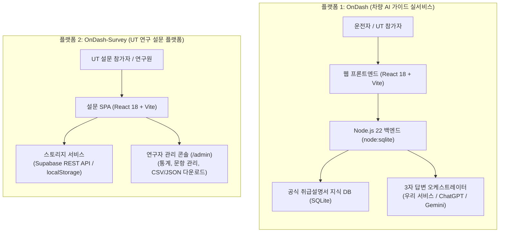
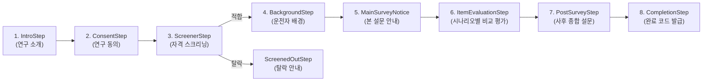

# OnDash & OnDash-Survey 완전 분리 플랫폼 구축 및 최종 인수인계 명세서 (Handover Spec)

> **문서 버전:** v2.0.0 (최종 분리 및 Git 재구축 완료본)  
> **최종 수정일:** 2026-10-13  
> **대상:** 다음 작업을 이어받을 LLM 및 개발자  
> **핵심 원칙:** 실서비스(OnDash)와 연구 설문(OnDash-Survey)은 **코드, Git 이력, 배포 단위가 100% 분리된 서로 다른 두 개의 독립 플랫폼**입니다. 절대 두 프로젝트를 섞지 마십시오.

---

## 📌 0. 중요 히스토리 및 현재 Git 상태 (필독)

과거 프로젝트에 실서비스와 설문 코드가 섞여 있어 메인 라우팅 충돌 및 배포 혼선이 발생했습니다.  
이에 따라 사용자의 요청으로 **과거의 Git 이력을 완전히 삭제하고, 실서비스만을 위한 Git을 처음부터 깨끗하게 새로 구축(Re-init)** 하였습니다.

* **실서비스 GitHub**: [https://github.com/eeyunjung/OnDash](https://github.com/eeyunjung/OnDash)
  * 과거의 얽혀 있던 설문 관련 커밋 이력을 모두 파기하고, **`feat: initial commit for OnDash live service`** 단 하나의 깨끗한 최초 커밋으로 새 출발했습니다.
  * 설문 관련 파일, 라우팅, 스크립트, 의존성이 0%인 순수 실서비스 전용 저장소입니다.
* **설문 플랫폼 로컬 경로**: `/Users/yunjung/.gemini/antigravity/scratch/ondash-survey`
  * 설문 시스템 전용으로 완전히 분리되어 독립 Git 저장소로 초기화 완료된 상태입니다.

---

## 🏗️ 1. 전체 분리 아키텍처 개요



| 비교 항목 | 플랫폼 1: OnDash (실서비스) | 플랫폼 2: OnDash-Survey (설문 플랫폼) |
| :--- | :--- | :--- |
| **서비스 목적** | 2025 아이오닉 5 기준 공식 차량 가이드 및 3자 답변 비교 | UT 참가자 대상 답변 신뢰도/유용성 평가 설문 및 연구 데이터 수집 |
| **로컬 디렉토리** | `/Users/yunjung/.gemini/antigravity/scratch/my-car-guide` | `/Users/yunjung/.gemini/antigravity/scratch/ondash-survey` |
| **GitHub 레포** | `https://github.com/eeyunjung/OnDash.git` | `https://github.com/eeyunjung/ondash-survey.git` (생성 대기) |
| **배포 환경** | Render Web Service (Node 22, Free) | Render Static Site / Vercel / Netlify (무료 정적 배포) |
| **예상 배포 URL** | `https://ondash.onrender.com` | `https://ondash-survey.onrender.com` |
| **비용 정책** | **0원** (내장 RAG 사용, 외부 유료 API 없음) | **0원** (정적 배포 + 무료 Supabase 또는 로컬스토리지) |

---

## 🚗 2. 플랫폼 1: OnDash (실서비스) 상세 명세

### 2.1 앱의 목적 및 사용자 경험
- **기준 차량**: **한국 판매 사양 2025년형 현대 아이오닉 5 NE1 (ccNC 인포테인먼트)**
- **UT 비교 대상**: 동일한 차량 가상 상황 카드에 대해 다음 3개 답변을 병렬 비교
  1. **우리 서비스 (OnDash)**: 공식 취급설명서에 근거한 단계별 안전 행동 안내
  2. **ChatGPT**: 일반 LLM 스타일 답변
  3. **Gemini**: 일반 LLM 스타일 답변
- **UT 가상 환경 원칙**: 실제 GPS나 실시간 차량 센서에 연결하지 않고, **가상 상황 카드(S1~S6 등)에 주어진 정보만을 사용**함.

### 2.2 반드시 지켜야 할 RAG 및 답변 원칙
1. **환각(Hallucination) 절대 금지**:
   - 확인되지 않은 차량 매뉴얼 내용, 페이지 번호, 가짜 출처 링크를 임의로 지어내지 말 것.
   - 공식 출처에 없는 수리 방법이나 자의적인 안전 행동을 답변으로 제안하지 말 것.
2. **근거 부족 시 명확한 한계 고지**:
   - 공식 근거가 없거나 연식/사양이 불일치할 경우:  
     👉 *"등록된 공식 자료에서 이 상황을 뒷받침하는 근거를 찾지 못했습니다."*  
     👉 *"차량 연식·사양에 맞는 근거를 확인할 수 없어 안전 행동을 단정할 수 없습니다."*
3. **우리 서비스 답변 출력 표준 순서**:
   1. 지금 우선할 행동 (운전자가 즉시 해야 할 조치)
   2. 그 행동이 필요한 이유
   3. 상황에서 확인할 조건
   4. 하지 말아야 할 행동 또는 주의점
   5. 다음 단계 (정비소, 긴급출동 등)
   6. 판단할 수 없는 부분 (현장 미확인 정보)
   7. 근거 (문서명, 해당 절/페이지, 공식 URL, 확인 일자)

### 2.3 UI/UX 및 인터랙션 구현 규칙 (절대 훼손 금지)
1. **헤더 및 시나리오 전환 모달**:
   * 상단 헤더에 'UT 가상 상황' 요약 및 우측 '시나리오 전환' 버튼 유지.
   * **홈 화면 중간에 중복되었던 'UT 가상 상황' 카드는 완전 삭제 상태 유지**.
   * 시나리오 전환 모달: 검정 박스가 아닌 시원한 큰 타이틀의 새 뎁스 모달, **실린더 아이콘 삭제**.
2. **맞춤 예상 질문 동적 위치 로직 (중복 노출 방지)**:
   * **질문 전 (첫 화면 / 초기 상태)**: 홈 중앙 카드 영역에 '현재 상황 맞춤 예상 질문' 노출.
   * **질문 후 (채팅 대화 시작 후)**: 홈 중앙에서는 숨겨지고, **채팅창 위(인풋창 바로 위)**에만 노출.
3. **인터랙션 및 애니메이션**:
   * 추천 질문 및 답변 등장 시 **부드럽고 살짝 느린 페이드업 인터랙션** (`opacity: 0 -> 1`, `translateY: 12px -> 0`, `transition: 400~500ms cubic-bezier(0.16, 1, 0.3, 1)`).
   * 버튼 및 칩 클릭 시 기분 좋은 탭 피드백 (`scale(0.97~0.98)`의 부드러운 눌림 효과).
4. **시각적 위계 및 편안한 색상**:
   * `'3가지 확인 후에도 문제가 지속되나요? 전문가 웹 검색 추가 안내'` 섹션:
     * `'3가지 확인 후에도 문제가 지속되나요?'` 와 다음 단락 사이에 **명확한 줄바꿈/여백** 유지.
     * 빨강/초록/보라색 원색 남발을 제거하고, 슬레이트 톤과 명확한 폰트 굵기(Bold/Medium), 크기(14px/12px) 위계 유지.

### 2.4 실서비스 코드 구조
```
my-car-guide/ (Git Remote: https://github.com/eeyunjung/OnDash.git)
├── index.html                  # 웹 진입점 (OnDash - 내 차 가이드 AI)
├── package.json                # "name": "ondash", Node >=22 engines
├── .nvmrc                      # 22
├── vite.config.js
├── HANDOVER_SPEC.md            # 인수인계 명세서
├── README.md                   # OnDash 실서비스 전용 설명서
├── server/                     # 백엔드 서버 (Node.js 22 built-in SQLite)
│   ├── index.js                # HTTP 서버 진입점 (포트 3000 또는 process.env.PORT)
│   ├── db.js                   # node:sqlite 기반 DB 초기화
│   ├── rag.js                  # 아이오닉 5 취급설명서 RAG 검색 엔진
│   ├── orchestrator.js         # 3자 답변 (우리 서비스 / ChatGPT / Gemini) 생성 오케스트레이터
│   └── tools/places.js         # 주변 정비소/휴게소 시설 검색
└── src/                        # 프론트엔드 (React 18)
    ├── main.jsx                # App 직접 렌더링
    ├── App.jsx                 # OnDash 메인 컨테이너 (Home, History, MyPage)
    ├── api.js                  # 백엔드 REST API 통신 모듈
    ├── index.css               # 글로벌 스타일 및 부드러운 인터랙션 키프레임
    └── components/
        ├── HomeTab.jsx         # 홈 화면, 상황 카드, 채팅창, 3자 비교 답변
        ├── UtScenarioModal.jsx # 시나리오 전환 모달
        ├── TriComparisonEvalModal.jsx # 3자 답변 비교 평가 모달
        ├── HistoryTab.jsx      # 질문 히스토리
        └── MyPageTab.jsx       # 차량 설정 및 마이페이지
```

---

## 📊 3. 플랫폼 2: OnDash-Survey (설문 조사 플랫폼) 상세 명세

### 3.1 플랫폼 목적 및 절차
UT 참가자를 대상으로 3가지 AI 답변(OnDash, ChatGPT, Gemini)을 블라인드/비교 평가하여 신뢰도, 정확도, 만족도 데이터를 수집하는 독립 설문 SPA입니다.



### 3.2 핵심 기능 명세
1. **문항 균형 배정 (`src/questionsBank.js`)**:
   * 참가자 편향을 방지하기 위해 문항 순서 및 AI 답변 노출 순서를 균형 할당.
2. **리커트 척도 인터페이스 (`src/components/LikertScale.jsx`)**:
   * 모바일/데스크톱 반응형 5점/7점 척도 평가 UI.
3. **하이브리드 스토리지 (`src/storageService.js`)**:
   * `VITE_SUPABASE_URL`, `VITE_SUPABASE_ANON_KEY`가 있으면 Supabase 원격 DB로 실시간 전송.
   * 환경변수가 없으면 자동으로 브라우저 `localStorage`에 완벽히 저장되어 테스트 가능.
4. **관리자 대시보드 (`src/admin/SurveyAdmin.jsx`)**:
   * URL: `/admin` 또는 `#admin` (비밀번호: 기본값 `admin2024!`)
   * 기능: 참가자 통계 요약, 문항 관리, 응답 원본 조회, 분석 차트, CSV/JSON 원클릭 내보내기.

### 3.3 설문 플랫폼 코드 구조
```
ondash-survey/ (새 Git 레포 예정: https://github.com/eeyunjung/ondash-survey.git)
├── index.html                  # 설문 진입점 (차량 상황에서 AI 답변 비교 설문)
├── package.json                # "name": "ondash-survey"
├── vite.config.js
├── HANDOVER_SPEC.md
├── supabase_schema.sql         # Supabase 테이블 DDL
└── src/
    ├── main.jsx
    ├── Router.jsx              # /admin -> SurveyAdmin, / -> SurveyApp
    ├── SurveyApp.jsx           # 설문 스텝 제어 메인 컨테이너
    ├── questionsBank.js        # 문항 은행 및 균형 알고리즘
    ├── storageService.js       # Supabase REST / localStorage 하이브리드 스토리지
    ├── steps/                  # 8단계 설문 스텝 컴포넌트
    ├── admin/                  # 관리자 대시보드 5개 탭
    └── components/             # 차트, 리커트 척도, 타이핑 텍스트 UI
```

---

## 📋 4. 다음 LLM 작업자 지침 (Action Guide)

### 🔴 절대 하지 말아야 할 것 (Red Lines)
1. **두 프로젝트 합치기 금지**: OnDash에 설문 코드를 다시 가져오거나, OnDash-Survey에 실서비스 백엔드를 결합하지 마십시오.
2. **출처 환각 금지**: 아이오닉 5 공식 매뉴얼에 없는 페이지 번호나 자의적 안전 절차를 지어내지 마십시오.
3. **Node 22 버전 변경 금지**: OnDash 백엔드는 `node:sqlite`를 사용하므로 Node.js 22 이상이 필수입니다.

### 🟢 작업 시 확인 순서
* **OnDash 실서비스 작업 시**:
  1. 작업 폴더: `/Users/yunjung/.gemini/antigravity/scratch/my-car-guide`
  2. 코드 수정 후 반드시 `npm run build` 확인.
  3. 커밋 후 `git push origin main` (원격: `https://github.com/eeyunjung/OnDash.git`).
  4. Render 배포 반영 여부 확인.
* **OnDash-Survey 설문 플랫폼 작업 시**:
  1. 작업 폴더: `/Users/yunjung/.gemini/antigravity/scratch/ondash-survey`
  2. 사용자가 새 레포지토리를 만들면 원격 등록 후 푸시:
     ```bash
     cd /Users/yunjung/.gemini/antigravity/scratch/ondash-survey
     git remote add origin https://github.com/eeyunjung/ondash-survey.git
     git branch -M main
     git push -u origin main
     ```
  3. Vercel, Netlify 또는 Render Static Site로 독립 배포 진행.
